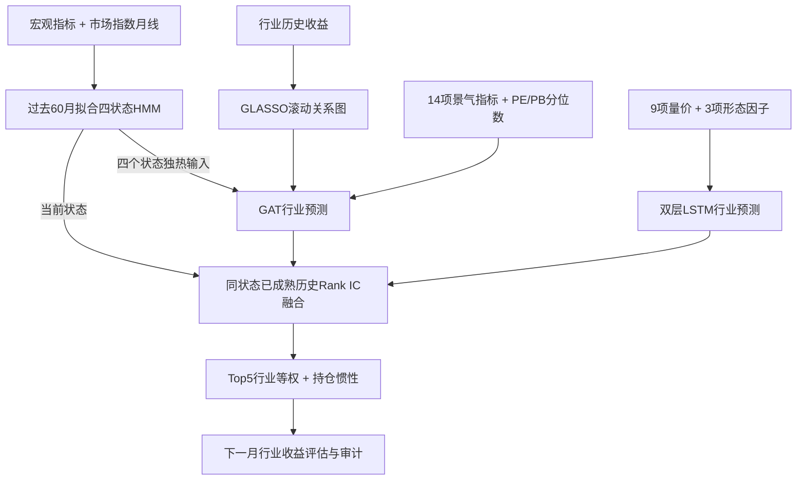

# HMM + GNN + LSTM 基础母版

这是从 [Regime-GNN-LSTM](https://github.com/boqi114514-web/Regime-GNN-LSTM) 整理出的**独立、可复用研究母版**。保留修复后的原始网络与训练逻辑：宏观四状态 HMM、GLASSO 行业关系图与 GAT、12 因子 LSTM、按已实现历史 IC 动态融合。

默认真正启用 HMM；不是把固定权重版本改个名字。基金比赛、日频交易、个股固定规则、Ridge/LightGBM、美股实验不在本仓库中。旧三个业务项目不被替换。

本仓库是从零起步的架构母版，不随仓库发布行情、密钥或训练权重。没有把旧版20%年化或基金90%累计收益作为本母版成绩。模拟示例只能证明程序完整运行。

## 框架



| 模块 | 基础设置 |
|---|---|
| HMM | 4状态、full协方差、历史60月、200次迭代；4个宏观特征＋8个市场走势特征 |
| GNN | 单层GAT，16维隐层；14项基本面＋2项估值分位数＋4项状态输入 |
| 图 | 信号月之前12个月收益构建GLASSO，Top8邻居、对称化；失败退回相关图，稀少样本为自环 |
| LSTM | 3个月序列，9量价＋3形态＋行业身份；64→32两层LSTM |
| 训练 | 60个月训练＋12个月验证；每3个月滚动；两分支各3种子 |
| 融合 | 当前状态最近12次已成熟Rank IC；负IC归零再归一化，无可用优势则50/50；不设LSTM最低权重 |
| 评估 | Top5行业等权，持仓惯性0.2；按下一持有月归属逐年收益 |

GAT目前用邻接是否非零作注意力掩码，不使用边权大小。状态编号按训练期三月市场动量由弱到强排列，不自动等同固定的“牛市／熊市”语义。前60月没有足够HMM历史时，GAT对应状态输入为0；后续预测必须有HMM覆盖。

## 先跑一个无需密钥的完整示例

建议 Python 3.11 或以上；CPU即可。依赖只包括NumPy、pandas、SciPy、scikit-learn、PyTorch、hmmlearn。

```bash
git clone https://github.com/boqi114514-web/HMM-GNN-LSTM-Template.git
cd HMM-GNN-LSTM-Template
python -m venv .venv
# Windows: .venv\Scripts\activate
# macOS/Linux: source .venv/bin/activate
python -m pip install -r requirements.txt
python -B run.py test
python -B run.py demo --out results/demo
```

`demo`生成12个虚构行业、78个月的合成输入，并依次训练HMM、GAT、LSTM、执行融合与五组对照。它使用轻量 `smoke` 配置：神经网络各2轮／1种子，HMM20次迭代；结构与60+12月训练窗口不变。数据默认生成在 `results/demo_data/`。示例中的形态因子是生成的替代值，不是历史形态检索流水线。

数据与输出目录必须不存在，重跑请换名字，例如 `results/demo2`。不会覆写之前的实验，也不会触碰原项目。运行时没有任何网络请求。

## 接入自己的数据

准备一个本地数据根目录，结构见 [数据契约](docs/DATA_CONTRACT.md)：

```text
my-data/
  raw/
    ts_macro_factors.csv
    ts_csi300_monthly.csv
    ts_sw_industry_monthly.csv
  processed/
    prosperity_indicators_clean.pkl
    price_volume_factors.pkl
    pattern_factors.pkl
```

```bash
python -B run.py check --data-dir /path/to/my-data
python -B run.py train --data-dir /path/to/my-data --out results/research-001
# 可选：覆盖configs/base.json中的部分已知参数
python -B run.py train --data-dir /path/to/my-data --config configs/my-config.json --out results/research-002
```

输入路径支持Windows绝对路径和相对路径；含空格时加引号。仅加载自己信任的pickle文件。数据接口保留原文件名以兼容已有材料，但行业代码本身可以替换为其他分类。默认排除旧架构的两个行业代码，使用其他节点时可以将 `SW_EXCLUDE` 设为空数组。模板不自动抓取同花顺／东财／申万成员，也不绑定某一供应商账号。

当前是**固定、完整行业池**的基础实现：至少10个节点，每月数据齐全；不支持新上市个股或动态行业池自动加入。GNN输入预先聚合的行业基本面，LSTM输入预先计算的行业因子。历史成员、公告版本与形态因子生成器应作为独立数据层接入，而不是隐藏在模型内部。

## 输出内容

- HMM特征、状态概率、拟合失败及收敛标记。
- GNN、LSTM、融合预测；最新没有收益答案的月份仍保留。
- `monthly_weights.csv`：HMM状态、两分支权重及已成熟IC数量。
- `holdings_*.csv`：各方案行业、换手、持有月和待实现状态。
- `monthly_returns.csv`、`annual_returns.csv`、`nav.csv`、`summary.csv`。
- `manifest.json`：来源版本、有效参数、输入与代码SHA-256、数据边界。
- 本地推理状态与模型权重；默认被Git排除。

同时输出 `gnn`、`lstm`、`fixed_50_50`、`hmm_gnn_lstm`、`industry_equal_weight` 五条相同区间序列，不按测试收益自动选赢家。

## 保留的修复与边界

- 行业按自然月对齐，收益统一由连续月收盘价计算，避免百分数与小数混用。
- 下一月标签服从训练／验证截止边界；尾部不足3个月的预测仍保留。
- LSTM只复用训练期标准化器；缺月或缺少训练期标准化器时停止，不跨空月拼序列或在预测期重拟合。
- 共享HMM状态独热不做行业截面标准化，避免状态输入全变为0。
- 融合先用已成熟历史IC定权重，再处理本期未来标签；可以额外提供更晚的标签可用日期。
- Top-K先按分数选，再核对收益；禁止因选中行业缺未来标签而事后换成下一名。
- 回撤包含初始净值1；最新未实现持仓不补造收益。
- 检查基本面／技术因子的行业月份覆盖，不让缺数据静默改变训练窗口。

宏观没有原始公告时间时，PMI／货币／社融按原修复方案滞后一个月；季度基本面保留“下一季度映射”的旧接口。**这些滞后约定不等于已恢复历史公告版本**，本母版没有解决供应商修订、历史行业归属和上游形态因子的所有时点问题。

当前收益对象是行业指数月末到次月末，不包含个股筛选、整手资金分配、下一开盘成交、停牌涨跌停或日频止损。扩展到股票、基金、ETF时，应独立实现对应数据及执行层，并重新验证，不能直接复用已有成绩。

## 后续怎么派生

在GitHub点击 **Use this template** 创建实验仓库；建议保留此仓库稳定，只在派生版本中改变一层：

1. 替换HMM输入，例如成交额、广度或波动；保留不带HMM的对照。
2. 替换行业图，例如细分题材多标签；检查图是否真的有有效连边。
3. 增减量价／基本面因子，严格保持相同数据与时间区间做消融。
4. 将预测接入单独的股票或基金资金账本，不把交易限制混入模型标签。

本轮整理与测试信息见 [验证记录](docs/VALIDATION.md)，来源与许可状态见 [NOTICE.md](NOTICE.md)。原仓库未声明明确开源许可证，本次没有替权利人擅自添加MIT等授权。
